# Computer Networks
## Types of Communication Between Two Devices

1. **Simplex**
2. **Half-duplex**
3. **Full-duplex**

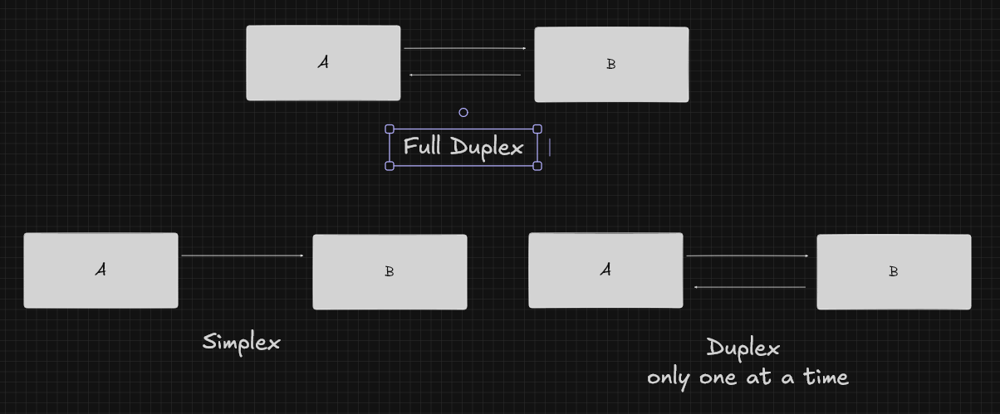

## Networks Based on Geographical Size

1. **LAN:** Local Area Network
2. **WAN:** Wide Area Network
3. **PAN:** Personal Area Network

# Protocol Layering

Protocol layering divides the communication process into multiple layers. Each layer performs a particular job and provides services to the layer above it.

- The **application layer** and **transport layer** are implemented in software on end systems.
- The **physical layer** and **data link layer** handle communication over a specific link.

## Advantages of Protocol Layering

- Provides a structured way to discuss network components.
- Modularity makes it easier to update individual system components.

## Potential Drawbacks

- One layer may duplicate functionality provided by a lower layer.
- A layer may need information available only in another layer, violating the goal of layer separation.

# TCP/IP Protocol Suite

## Encapsulation and Decapsulation

- **Encapsulation** occurs at the sender's host.
- **Decapsulation** occurs at the receiver's host.

## Application Layer

- The layer where network applications and application-layer protocols reside.
- Includes protocols such as:
  - HTTP
  - SMTP
  - FTP
  - SSH (Secure Shell)
  - TELNET (Terminal Network)
  - SNMP (Simple Network Management Protocol)
  - DNS (Domain Name System)

## Transport Layer

- Transports application-layer messages between application endpoints.
- Data received from the layer above is segmented into smaller units.

### Transport-Layer Protocols

- **UDP (User Datagram Protocol)**
- **TCP (Transmission Control Protocol):**
  - Establishes a connection between hosts before sending data.
  - Provides flow control and error control.
- **SCTP (Stream Control Transmission Protocol)**

## Network Layer

- Responsible for moving network-layer packets (datagrams).
- Determines how packets should move towards their destinations.
- Uses IP for logical addressing.
- Applications use port numbers at the transport layer.
- **Routing:** Determines a path towards the destination.
- **Forwarding:** Moves a packet from one interface to another, usually through a router.

### Devices

- Routers

### Network-Layer and Related Protocols

- **IP (Internet Protocol):** Provides logical addressing and packet delivery.
- **ICMP (Internet Control Message Protocol):** Helps IP report problems encountered while routing or delivering packets.
- **IGMP (Internet Group Management Protocol):** Supports IP multicast group management.
- **DHCP (Dynamic Host Configuration Protocol):** Helps a host obtain network configuration, including an IP address.
- **ARP (Address Resolution Protocol):** Helps find the link-layer address associated with a known IPv4 address on a local network.

### IP Addressing

#### IPv4

- IPv4 addresses are **32 bits** long.
- They are written as four decimal numbers separated by dots.
- Example: `192.168.1.10/24`
- Each octet contains 8 bits, so an IPv4 address has four 8-bit octets.

For `192.168.1.10/24`:

- `192.168.1` represents the network portion in this example.
- `10` represents the host portion in this example.
- `/24` means the first 24 bits are the network portion.
- Each octet can have a value from `0` to `255`.

#### Subnet Mask

A subnet mask determines which part of an IP address represents the network and which part represents the host.

For a typical IPv4 subnet:

- Usable host addresses = \(2^{\text{host bits}} - 2\)

#### Special IPv4 Addresses

- `127.0.0.0/8`: Loopback address range.
- `0.0.0.0`: Unspecified address; it can also represent a default route when used as `0.0.0.0/0`.

### Routers

- Receive packets and forward them towards their destinations using IP addresses.
- Operate at the network layer.
- Connect different networks.

## Data Link Layer

- Moves frames across a single link.
- A frame contains a network-layer packet and link-layer information, such as:
  - Source link-layer address
  - Destination link-layer address
  - Control information
  - Error-detection information
- Passes frames to the physical layer.
- Uses MAC addresses.
- Common devices include switches and bridges.

### Protocols

- Ethernet
- PPP (Point-to-Point Protocol)
- ARP (Address Resolution Protocol)

## Physical Layer

- Transmits individual bits over a physical medium.

# Transmitting Data

- Two transmission approaches are **baseband** and **broadband**.

## Bit Rate and Bit Length

- **Bit rate:** Number of bits sent per second.
- **Bit length:** Distance occupied by one bit.

\[
\text{Bit length} = \text{Propagation speed} \times \text{Bit duration}
\]

Equivalently,

\[
\text{Bit length} = \frac{\text{Propagation speed}}{\text{Bit rate}}
\]

## Baseband Transmission

- Baseband transmission requires a low-pass channel.
- A digital signal contains harmonics such as \(f\), \(3f\), and \(5f\).
- A wider bandwidth allows more harmonics to pass through.

### Low-Pass Channel with Wide Bandwidth

- The more harmonics that pass through the channel, the more accurately the signal can be represented.

## Broadband Transmission (Using Modulation)

- Uses a band-pass channel.

## Transmission Impairments

- **Attenuation:** Loss of signal energy.
  - Decibel ratio: `dB = 10 log10(P₂/P₁)` for a power ratio.
- **Distortion:** A change in the shape of a signal.
- **Noise:** Unwanted energy that affects a signal.
  - `SNR = Average signal power / Average noise power`

## Data-Rate Limits

### Noiseless Channel (Nyquist Bit Rate)

\[
\text{Bit rate} = 2 \times BW \times \log_2 L
\]

- `BW` is bandwidth.
- `L` is the number of signal levels.

### Noisy Channel (Shannon Capacity)

\[
\text{Capacity} = BW \times \log_2(1 + SNR)
\]

- Shannon capacity gives the theoretical maximum data rate for a noisy channel.
- The Nyquist formula relates the maximum data rate of a noiseless channel to its bandwidth and number of signal levels.

# Network Performance

## Bandwidth

- Bandwidth can refer to frequency range in hertz (Hz).
- In networking, the term is also commonly used for a link's data-carrying capacity in bits per second.

## Throughput

- Measures how much data is successfully transferred through a network per unit of time.

## Latency and Delay

Total latency can include:

- Propagation time
- Transmission time
- Queuing time
- Processing delay

### Propagation Time

Time required for a signal to travel from source to destination.

\[
\text{Propagation time} = \frac{\text{Distance}}{\text{Propagation speed}}
\]

### Transmission Time

Time required to put all bits of a message onto the link.

\[
\text{Transmission time} = \frac{\text{Message size in bits}}{\text{Data rate in bits/s}}
\]

### Queuing Time

Time a device holds a packet while it waits to be processed or transmitted.

### Jitter

Variation in packet delay: different packets may experience different delays.

# Line Encoding

Line encoding converts digital data into digital signals.

## Desirable Properties

- Self-synchronisation
- Built-in error detection, where supported by the scheme
- Immunity to noise and interference

## Data Elements and Signal Elements

- **Data element:** The information being carried.
- **Signal element:** The signal unit used to represent the data.
- `r`: Number of data elements carried by each signal element.
- **Data rate (`N`):** Number of data bits sent per second (bps).
- **Signal rate (`S`):** Number of signal elements sent per second (baud).

\[
S = \frac{N}{r}
\]

A commonly used estimate for signal rate is:

\[
S_{\text{avg}} = c \times N \times \frac{1}{r}
\]

- `N` is the data rate.
- `r` is the number of data elements per signal element.
- `c` is a case-dependent factor.

Minimum bandwidth is sometimes estimated as:

\[
B_{\min} = c \times N \times \frac{1}{r}
\]

Maximum data rate can be expressed as:

\[
N_{\max} = \frac{1}{c} \times B \times r
\]

## Line-Encoding Schemes

- **Unipolar:** NRZ
- **Polar:** NRZ-L, NRZ-I, RZ, Manchester, Differential Manchester
- **Bipolar:** AMI, Pseudoternary
- **Multilevel:** 2B/1Q, 8B/6T, 4D-PAM5

## Unipolar Encoding

### NRZ

- A signal level is maintained for the entire bit interval.

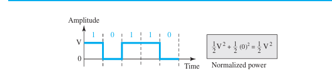

### RZ

- The signal returns to zero during each bit interval.

## Polar Encoding

### NRZ-L

- Uses different voltage levels for different bit values.
- In the convention used in these notes, `1` is represented by `+1` and `0` by `-1`.

### NRZ-I

- A `1` causes a transition.
- A `0` causes no transition.

### RZ

- For a `1`, the signal is `+1` for half the bit interval and then returns to zero.
- For a `0`, the signal is `-1` for half the bit interval and then returns to zero.
- The signal rate is often given as approximately `N` for this convention; it depends on the exact signal pattern.

### Manchester

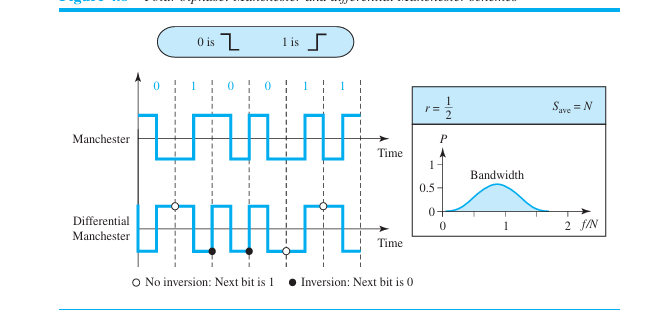

- There is a transition in the middle of each bit interval.
- The minimum bandwidth is approximately twice that of NRZ.

### Differential Manchester

- There is always a transition in the middle of each bit interval.
- In the convention used in these notes, a transition at the beginning represents `0`, while no transition at the beginning represents `1`.
- Has no DC component and avoids baseline-wandering problems.

## Bipolar Encoding

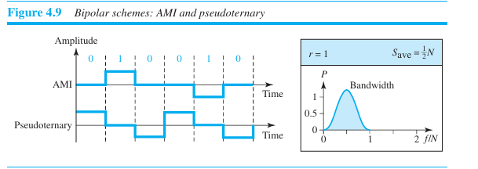

### AMI (Alternate Mark Inversion)

- A `0` is represented by zero voltage.
- Successive `1` bits alternate between positive and negative voltage.
- Can be used for long-distance communication.
- Long sequences of zeros can cause synchronisation problems.

### Pseudoternary

- A `1` is represented by zero voltage.
- Successive `0` bits alternate between positive and negative voltage.

## Multilevel Encoding

- Used to increase data rate without increasing bandwidth proportionally.

### 2B/1Q

- Means 2 binary elements are mapped to 1 quaternary signal element.
- `m = 2`, `n = 1`, `L = 4`.
- The average signal rate is given in these notes as `N/4`.

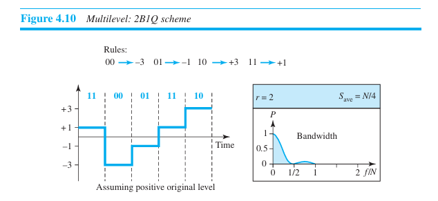

### 8B/6T

- Maps 8 binary elements to 6 ternary signal elements.
- Redundant signal patterns can help with synchronisation and error detection.

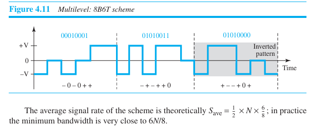

### 4D-PAM5

- Four-dimensional, five-level pulse-amplitude modulation.

# Digital-to-Analog Conversion

Main schemes:

- Amplitude Shift Keying (ASK)
- Frequency Shift Keying (FSK)
- Phase Shift Keying (PSK)

The relationship between data rate and signal rate is:

\[
S = \frac{N}{r}, \qquad r = \log_2 L
\]

- `N` is the data rate.
- `S` is the signal rate in baud.
- `L` is the number of distinct signal elements.

## Amplitude Shift Keying (ASK)

### Binary ASK / On-Off Keying

- One binary value is represented by a carrier with a particular amplitude.
- The other value is represented by zero amplitude.

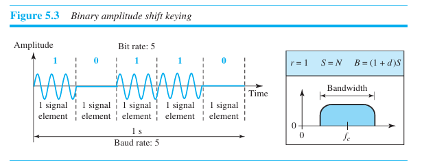

- `r = 1` for binary ASK.
- Approximate bandwidth: `BW = (1 + d)S`, where `d` is a factor between 0 and 1.

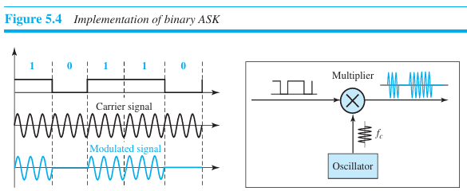

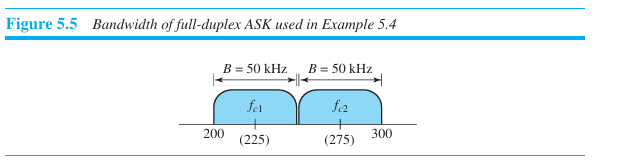

## Frequency Shift Keying (FSK)

### Binary FSK (BFSK)

- Uses two frequencies, `f₁` and `f₂`.
- One frequency represents `0`, and the other represents `1`.

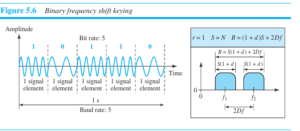

- Approximate bandwidth: `BW = (1 + d)S + 2Δf`.

### M-ary FSK (MFSK)

- Uses multiple frequencies to represent different symbols.
- Approximate bandwidth:

\[
BW = (1 + d)S + (L - 1)2\Delta f
\]

- The minimum value of `2Δf` is typically related to the signal rate `S`.
- Under the stated minimum-spacing assumption, the bandwidth may be approximated as `BW ≈ L × S`.

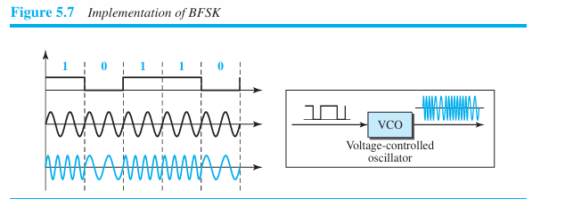

## Phase Shift Keying (PSK)

### BPSK

- Uses two signal elements with phases of `0°` and `180°`.
- Less susceptible to noise than ASK in many practical conditions.

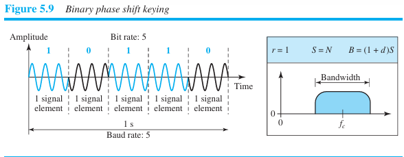

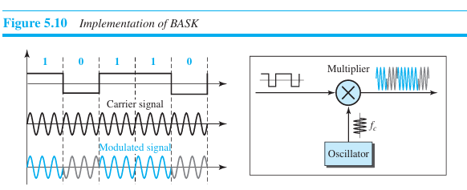

- Commonly associated with polar NRZ signalling.

### QPSK

- Uses four phase states to represent two bits per symbol.
- Can be viewed as combining two BPSK components: in-phase (I) and quadrature (Q).

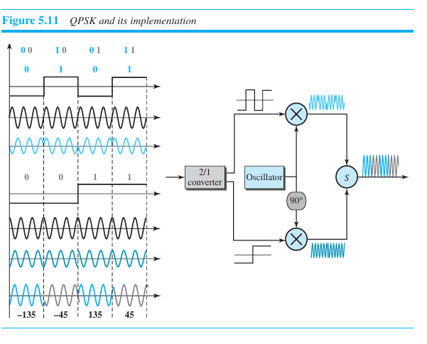

# Transmission Media

Transmission media are classified as:

- **Guided media**
- **Unguided media**

## Guided Media

Includes:

- Twisted-pair cable
- Coaxial cable
- Optical fibre

### Twisted-Pair Cable

- **UTP:** Unshielded Twisted Pair
- **STP:** Shielded Twisted Pair
- Twisting and shielding help reduce noise and interference.
- RJ-45 connectors are commonly used with Ethernet twisted-pair cabling.

### Coaxial Cable

Common cable types:

- **RG-59:** Commonly used for cable television.
- **RG-58:** Historically used for thin Ethernet.
- **RG-11:** Used in some cable television and other RF applications; historically associated with thick Ethernet.

- A common coaxial connector type is BNC.

### Optical Fibre

Advantages:

- High bandwidth
- Low signal attenuation
- Lightweight

#### Propagation Modes and Fibre Types

- **Step-index fibre:** The refractive index of the core is approximately constant.
- **Graded-index fibre:** The refractive index changes gradually across the core, helping reduce modal dispersion.
- **Single-mode fibre:** Supports one main propagation mode.
- **Multimode fibre:** Allows multiple light paths through the core.

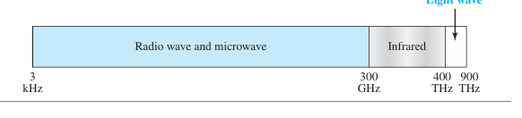

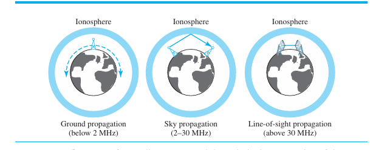

A disadvantage of optical fibre is that a basic fibre link is generally one-way; two-way communication usually uses separate fibres or other arrangements.

## Unguided Media

# OSI Model

The OSI model has seven layers:

1. Application Layer
2. Presentation Layer
3. Session Layer
4. Transport Layer
5. Network Layer
6. Data Link Layer
7. Physical Layer

## Presentation Layer

- Provides services that allow communicating applications to interpret the meaning of exchanged data.
- Handles functions such as data compression and encryption.

## Session Layer

- Responsible for establishing, managing, and terminating communication sessions between applications.
